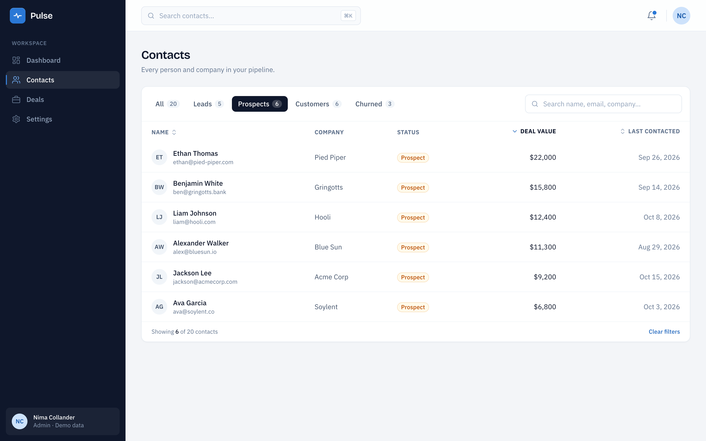

# Pulse CRM

A sales dashboard and CRM built with **Next.js 16 (App Router)**, **React 19**, **TypeScript** and **Tailwind CSS v4**. It tracks revenue against quota, manages contacts, and runs a drag-and-drop deals pipeline.


## Features

**Dashboard**
- Revenue-vs-quota chart with a month-end projection and quota pace line. Hover or use the arrow keys to read any day, or switch to a table view.
- Quota meter showing attainment against where pace says you should be, plus projected finish, revenue needed per day, and days left.
- KPI tiles (leads, win rate, active deals, average deal size) with 12-week sparklines.
- Open pipeline by stage with a weighted forecast, and a list of deals closing soon.

**Contacts**
- Search, status filters and sortable columns, all stored in the URL (e.g. `/contacts?status=lead&sort=name`), so any view can be shared or bookmarked.
- A detail page for each contact with their info and linked deals.

**Deals pipeline**
- Kanban board across five stages. Drag with a mouse, touch, or the keyboard.
- Moves appear instantly and save on the server in the background. If a save fails, the card snaps back and an error is shown.
- Pipeline totals and win rate update live as cards move.

**Everywhere**
- Responsive down to phone width, with a slide-in navigation drawer.
- <kbd>⌘K</kbd> / <kbd>Ctrl K</kbd> focuses search from any page.

<table>
  <tr>
    <td></td>
    <td></td>
  </tr>
  <tr>
    <td align="center">Deals pipeline</td>
    <td align="center">Contacts, filtered and sorted</td>
  </tr>
</table>

## Tech stack

| Area | Choice |
| --- | --- |
| Framework | Next.js 16 (App Router, Server Components, Server Actions) |
| Language | TypeScript (strict) |
| Styling | Tailwind CSS v4 with custom design tokens |
| Drag and drop | [@dnd-kit/core](https://dndkit.com) |
| Charts | Hand-built SVG, no chart library |
| Fonts | IBM Plex Sans and Bricolage Grotesque via `next/font` |

## Technical highlights

**Caching and partial prerendering.** The app uses Next.js Cache Components. Pages render as a static shell, and only the parts that depend on the request stream in behind `Suspense`. For example, the Contacts heading is prerendered while the filtered table streams in. Deal reads are cached with `'use cache'` and tagged, and the Server Action that moves a deal calls `updateTag('deals')`, so the board, dashboard and contact pages all show the change.

**Instant updates with Server Actions.** The deals board uses React's `useOptimistic`. A card moves the moment it's dropped, the Server Action saves the change, and the server's response replaces the temporary state. If the action fails, React drops the temporary move by itself. The action also validates its inputs on the server, since Server Actions are public endpoints.

**The URL holds the state.** Contacts search, filters and sorting live in the query string. Filtering and sorting happen on the server, and the only browser-side code is a debounced search box.

**Accessibility.**
- Drag and drop works from the keyboard: arrow keys jump a whole column, and each step is announced to screen readers.
- The revenue chart can be read with the arrow keys and has a table alternative.
- Navigation and table headers use proper `aria-current` and `aria-sort`.
- Animations respect `prefers-reduced-motion`.

**Data visualization.** Chart colors were checked with a colorblind-safety validator. Projected revenue reuses the closed-revenue blue but is dashed and starts at today, so it's told apart by line style and position, not color alone. Values are labeled directly instead of being hidden in tooltips.

**A separate data layer.** Components never touch data directly. They call `lib/contacts.ts`, `lib/deals.ts` and `lib/dashboard.ts`, so moving to a real database only means changing those files.

## Project structure

```
app/
  page.tsx                 Dashboard
  contacts/                Contacts list and [id] detail pages
  deals/                   Pipeline board and its Server Action
components/
  dashboard/               Revenue pace chart, KPI strip, pipeline, closing soon
  contacts/                Table, search, status filters
  deals/                   Board, columns, draggable cards
  layout/                  App shell, sidebar, header
  ui/                      Shared building blocks (Card, StatusBadge…)
lib/                       Data access, formatting, shared config
types/                     Shared TypeScript types
```

## Getting started

Requires Node.js 20.9 or later.

```bash
git clone https://github.com/nimacollander/dashboard-crm.git
cd dashboard-crm
npm install
npm run dev
```

Then open [http://localhost:3000](http://localhost:3000).

| Script | What it does |
| --- | --- |
| `npm run dev` | Start the development server |
| `npm run build` | Create a production build |
| `npm run start` | Serve the production build |
| `npm run lint` | Run ESLint |

## Demo data and limitations

This is a portfolio project, so a few things are simplified on purpose:

- **Data is mock data held in memory.** Moving a deal persists until the server restarts, then resets.
- **"Today" is fixed at October 18, 2026**, so the dashboard reads the same on every visit.
- **There's no login.** The Server Action validates its inputs but doesn't check who's calling it.
- **Settings is a placeholder page.**

## Roadmap

- [ ] Postgres database (Neon + Drizzle) in place of the in-memory store
- [ ] Deploy to Vercel
- [ ] Forms to add contacts and deals
- [ ] Settings page (profile, monthly quota)
- [ ] Unit tests and a browser test for drag and drop, with CI
- [ ] Dark mode
