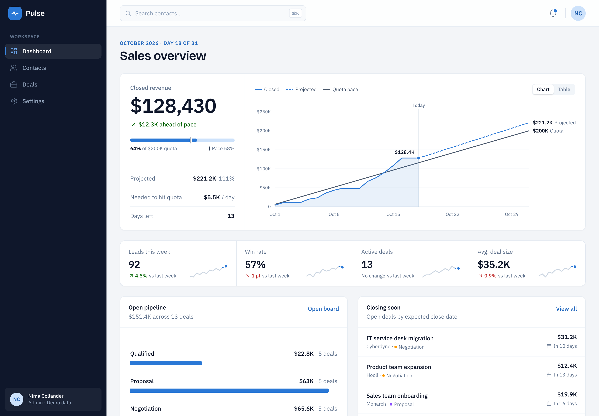
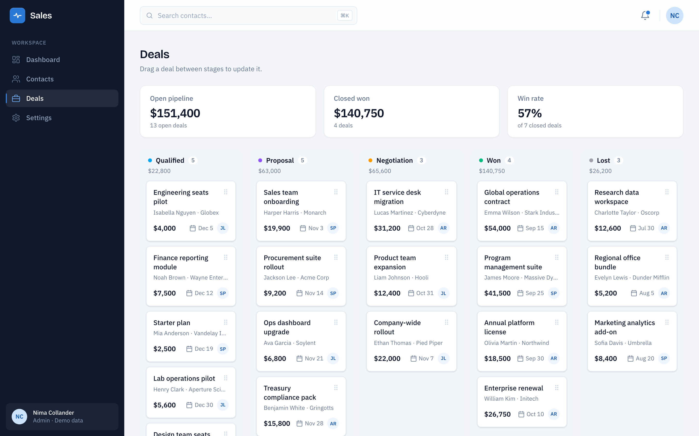
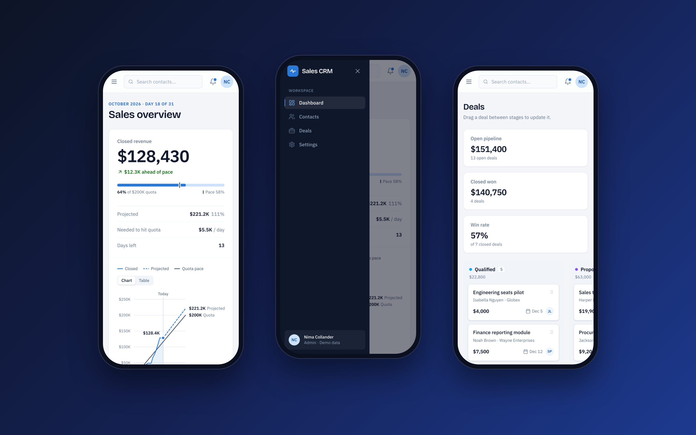
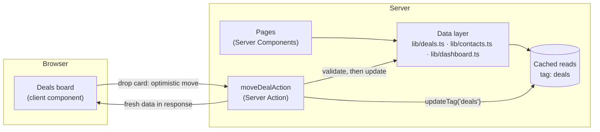

# Pulse CRM

**A sales dashboard and CRM for tracking revenue against quota, managing contacts, and moving deals through a pipeline.**

Built with Next.js 16 (App Router), React 19, TypeScript and Tailwind CSS v4, using Server Components, Server Actions and Cache Components.




## Contents

- [Overview](#overview)
- [Features](#features)
- [Tech stack](#tech-stack)
- [Architecture](#architecture)
- [Technical highlights](#technical-highlights)
- [Getting started](#getting-started)
- [Project structure](#project-structure)
- [Scope and limitations](#scope-and-limitations)
- [Roadmap](#roadmap)

## Overview

Pulse is a CRM for a small sales team. It answers three everyday questions:

1. **Are we on track this month?** The dashboard compares closed revenue with the quota and projects where the month will finish.
2. **Who are we talking to?** The contacts list can be searched, filtered and sorted, and each contact has a detail page with their linked deals.
3. **Where is each deal?** A drag-and-drop board moves deals between stages and updates the totals immediately.

The project focuses on how a production React app should behave: fast first loads, instant feedback when data changes, full keyboard and screen-reader support, and a layout that works from a phone to a wide desktop.

<table>
  <tr>
    <td width="50%"></td>
    <td width="50%"></td>
  </tr>
  <tr>
    <td align="center"><b>Deals pipeline</b>: drag and drop with optimistic updates</td>
    <td align="center"><b>Mobile</b>: dashboard, navigation drawer and deals board</td>
  </tr>
</table>

## Features

### Dashboard
- **Revenue vs. quota chart** with a month-end projection and a quota pace line. Hover or use the arrow keys to read any day, or switch to a table view.
- **Quota meter** showing attainment against where pace says you should be, plus projected finish, revenue needed per day and days left.
- **KPI tiles** for leads, win rate, active deals and average deal size, each with a 12-week sparkline.
- **Open pipeline by stage** with a weighted forecast, and a list of deals closing soon.

### Contacts
- Search, status filters and sortable columns, all kept in the URL (for example `/contacts?status=lead&sort=name`), so any view can be bookmarked or shared.
- A detail page for each contact with their information and linked deals.

### Deals pipeline
- Kanban board across five stages: Qualified, Proposal, Negotiation, Won and Lost.
- Works with a mouse, touch, or the keyboard.
- Moves appear instantly and save on the server in the background. If a save fails, the card returns to its column and an error is shown.
- Pipeline totals and win rate update live as cards move.

### Across the app
- Responsive layout down to phone width, with a slide-in navigation drawer.
- <kbd>⌘K</kbd> / <kbd>Ctrl K</kbd> focuses search from any page.
- Loading skeletons while data streams in, and a dedicated not-found page for unknown contacts.

## Tech stack

| Area | Choice |
| --- | --- |
| Framework | Next.js 16: App Router, Server Components, Server Actions, Cache Components |
| UI | React 19 (`useOptimistic`, `Suspense`) |
| Language | TypeScript in strict mode |
| Styling | Tailwind CSS v4 with custom design tokens |
| Drag and drop | [@dnd-kit/core](https://dndkit.com) |
| Charts | Hand-built SVG, no chart library |
| Fonts | IBM Plex Sans and Bricolage Grotesque via `next/font` |
| Code quality | ESLint (`eslint-config-next`) |

## Architecture

Most of the app renders on the server. Only the parts that need interaction (the deals board, the chart, the search box and the navigation drawer) run in the browser. Components never read data directly. They go through a small data layer in `lib/`.



**What happens when a deal is moved:**

1. The card moves on screen straight away (`useOptimistic`).
2. The Server Action checks its inputs and updates the deal.
3. `updateTag('deals')` expires every cached read of deals, so the board, the dashboard and the contact pages all show the change.
4. The response replaces the temporary state. If the action fails, React discards the optimistic move and the card returns to its column.

## Technical highlights

**Caching and partial prerendering.** The app uses Next.js Cache Components. Each page is served as a prerendered static shell, and only the request-dependent parts stream in behind `Suspense`. For example, the Contacts heading is static while the filtered table streams in. Deal reads are cached with `'use cache'` and tagged, so a single mutation invalidates every view that depends on it.

**Optimistic updates with Server Actions.** The deals board responds immediately, without waiting for the network, and rolls back cleanly on failure. Server Actions are public endpoints, so the action validates its arguments on the server instead of trusting the client.

**The URL holds the state.** Search, filters and sorting on the Contacts page live in the query string and are applied on the server. The only browser-side code there is a debounced search box. Views survive reloads and can be shared as links.

**Accessibility.**
- Drag and drop works from the keyboard: arrow keys move a card across columns, and each step is announced to screen readers.
- The revenue chart can be read with the arrow keys and has a data-table alternative.
- Navigation and sortable table headers use `aria-current` and `aria-sort`.
- Animations respect `prefers-reduced-motion`.

**Data visualization.** Chart colors were checked for colorblind safety. Projected revenue uses the same blue as closed revenue but is dashed and starts at today, so it is told apart by line style and position, not color alone. Key values are labeled directly on the chart instead of being hidden in tooltips.

**A replaceable data layer.** All data access goes through `lib/contacts.ts`, `lib/deals.ts` and `lib/dashboard.ts`. Moving from the in-memory store to a real database only means changing those files, not the components.

## Getting started

**Requirements:** Node.js 20.9 or later.

```bash
git clone https://github.com/nimacollander/dashboard-crm.git
cd dashboard-crm
npm install
npm run dev
```

Then open [http://localhost:3000](http://localhost:3000).

| Script | What it does |
| --- | --- |
| `npm run dev` | Start the development server |
| `npm run build` | Create a production build |
| `npm run start` | Serve the production build |
| `npm run lint` | Run ESLint |

No environment variables or external services are needed. The app runs on built-in demo data.

## Project structure

```
app/
  page.tsx                 Dashboard
  contacts/                Contacts list and [id] detail pages
  deals/                   Pipeline board and its Server Action
  settings/                Settings (placeholder)
components/
  dashboard/               Revenue pace chart, KPI strip, pipeline, closing soon
  contacts/                Table, search, status filters, loading skeleton
  deals/                   Board, columns, draggable cards
  layout/                  App shell, sidebar, header
  ui/                      Shared building blocks (Card, StatusBadge…)
lib/                       Data access, formatting, shared config
types/                     Shared TypeScript types
docs/screenshots/          Images used in this README
```

## Scope and limitations

This is a portfolio project, so some parts are simplified on purpose:

- **Data is mock data held in memory.** Moving a deal persists until the server restarts, then resets.
- **"Today" is fixed at October 18, 2026**, so the dashboard looks the same on every visit.
- **There is no login.** The Server Action validates its inputs but does not check who is calling it.
- **Settings is a placeholder page.**

## Roadmap

- [ ] A real database in place of the in-memory store
- [ ] Deployment with a live demo link
- [ ] Forms to create and edit contacts and deals
- [ ] User accounts with a one-click demo login
- [ ] Settings page (profile, monthly quota)
- [ ] Automated tests and continuous integration
- [ ] Dark mode

## Author

**Nima Collander** · [GitHub](https://github.com/nimacollander)
